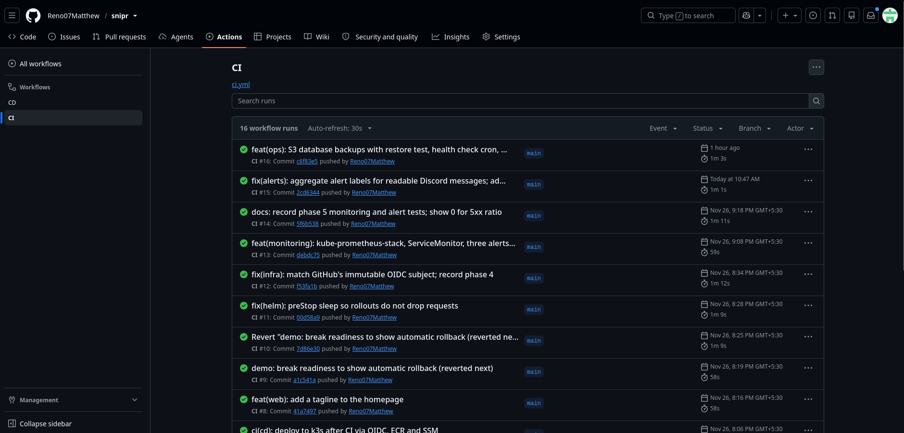
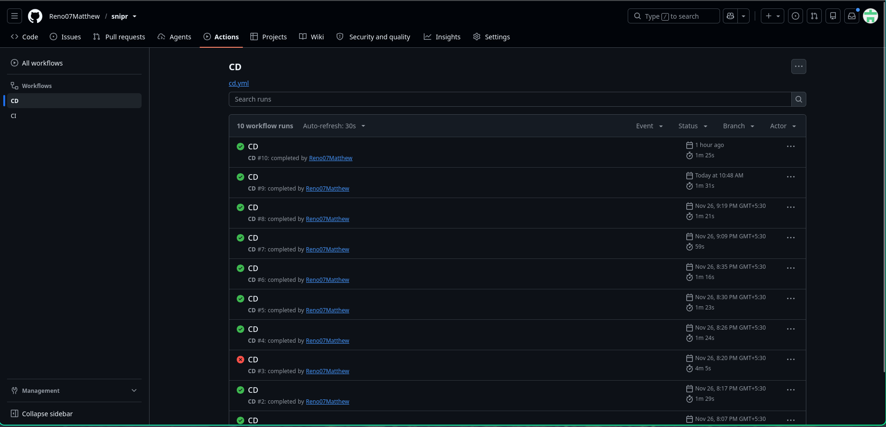
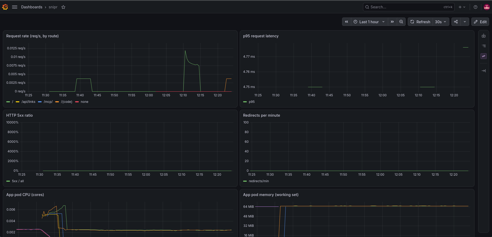
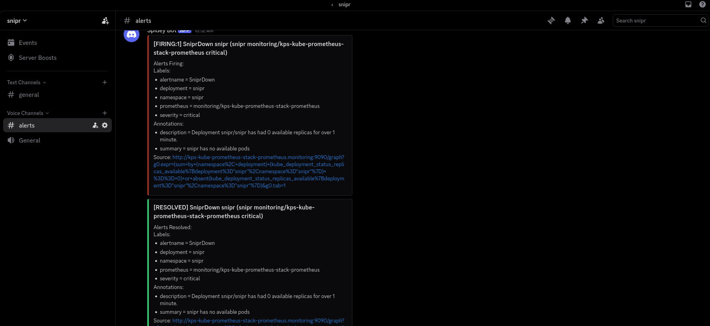
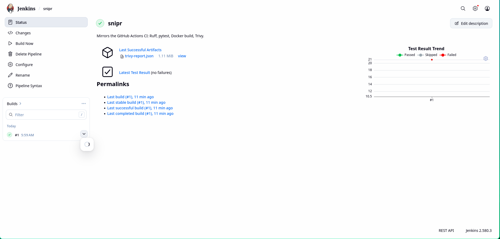

# snipr

A small URL-shortener API, used to build an end-to-end DevOps / DevSecOps
platform on AWS: tested and scanned in CI, provisioned with Terraform, deployed to
Kubernetes (k3s) with Helm by an automated CD pipeline, monitored with Prometheus
and Grafana, and backed up to S3.

The application is deliberately small. The point is the platform around it, and
that every part of it is understood, tested, and documented with real evidence.

> **Status:** Phases 0–6 are done and verified (evidence in [docs/notes](docs/notes)).
> Phase 7 (this documentation) is in final review.

## Contents

- [Architecture](#architecture)
- [Skills and technology](#skills-and-technology)
- [Run locally](#run-locally)
- [API](#api)
- [CI](#ci)
- [CD](#cd)
- [Infrastructure (Terraform)](#infrastructure-terraform)
- [Kubernetes and Helm](#kubernetes-and-helm)
- [Monitoring and alerting](#monitoring-and-alerting)
- [Backup and restore](#backup-and-restore)
- [Operations scripts and Jenkins](#operations-scripts-and-jenkins)
- [Security controls](#security-controls)
- [Failure simulations](#failure-simulations)
- [Screenshots](#screenshots)
- [Challenges and lessons](#challenges-and-lessons)
- [Known limitations](#known-limitations)
- [Cost](#cost)
- [Teardown](#teardown)
- [Versions](#versions)

## Architecture



Source: [docs/architecture.mmd](docs/architecture.mmd) (Mermaid). Regenerate the
SVG with `make diagram`.

1. **A push or pull request** runs CI on GitHub Actions: lint, tests, image build,
   vulnerability scan and secret scan. CI has no AWS access.
2. **When CI passes on `main`,** CD assumes an AWS role through GitHub OIDC (no
   stored keys). It pushes the image (tagged with the commit SHA) and the Helm chart
   to ECR, then runs `helm upgrade` on the node through SSM Run Command (no inbound
   SSH from CI).
3. **One EC2 instance runs k3s.** Traefik serves the app on port 80. PostgreSQL runs
   as a StatefulSet. Prometheus, Grafana and Alertmanager run privately in the
   `monitoring` namespace.
4. **Cron on the node** backs up the database to S3, checks health, and refreshes
   the ECR pull secret.

## Skills and technology

| Skill area | How this project shows it |
|---|---|
| Cloud (AWS) | VPC, subnet, security group, EC2, Elastic IP, IAM roles and instance profile, ECR, S3, SSM, Budgets; region `ap-south-1` |
| CI/CD and automation | GitHub Actions CI (lint, test, build, scan) and CD (OIDC, ECR, SSM, Helm with automatic rollback) |
| Infrastructure as Code | Terraform in two stacks, remote state in S3 with native locking, TFLint |
| Containers | Multi-stage, non-root Docker image; Docker Compose for local development |
| Kubernetes | k3s, Helm chart, Deployment, StatefulSet, PVC, Ingress, HPA, probes, resource limits |
| Monitoring and infrastructure management | Prometheus, Grafana dashboard, Alertmanager to Discord, alert rules with unit tests |
| Linux and shell scripting | Bash scripts with `set -euo pipefail`, ShellCheck, cron, logrotate, cloud-init |
| Git and version control | Pull-request CI, pinned dependencies, conventional commits |
| Jenkins | A Jenkinsfile mirroring the CI, run on Jenkins configured as code |
| Security (DevSecOps) | Trivy, Gitleaks, OIDC instead of keys, least-privilege IAM, private monitoring, secrets kept out of Git |

## Run locally

Needs Docker with Compose.

```bash
cp .env.example .env            # then change POSTGRES_PASSWORD
docker compose up --build -d --wait
curl -i http://localhost:8000/healthz
curl -i http://localhost:8000/readyz
docker compose down             # keeps data; adding -v DELETES the database volume
```

| Variable | Purpose |
|---|---|
| `POSTGRES_USER`, `POSTGRES_PASSWORD`, `POSTGRES_DB` | Compose database settings (password: letters, digits, `-`, `_`) |
| `BASE_URL` | Prefix for returned short links |
| `DATABASE_URL` | Read by the app; Compose and the Helm chart build it from the values above |

Tests: see [docs/notes/phase1.md](docs/notes/phase1.md).

## API

| Method | Route | Behaviour |
|---|---|---|
| `POST` | `/api/links` | Create a short link (`http`/`https` only), returns 201 |
| `GET` | `/{code}` | Redirect with 307 and count the hit |
| `GET` | `/api/links/{code}` | Link statistics |
| `GET` | `/healthz` | Liveness; does not touch the database |
| `GET` | `/readyz` | Readiness; checks the database |
| `GET` | `/metrics` | Prometheus metrics (blocked from the internet on AWS) |

```bash
curl -X POST http://localhost:8000/api/links \
  -H 'Content-Type: application/json' -d '{"url": "https://example.com"}'
curl -i http://localhost:8000/<code>          # 307 to https://example.com
curl http://localhost:8000/api/links/<code>    # {"code": ..., "hits": 1, ...}
```

## CI

`.github/workflows/ci.yml` runs on pull requests and pushes to `main`, with
read-only permissions and no AWS credentials. Actions are pinned to commit SHAs
and tool images to digests.

1. **test:** Ruff lint and format check, then pytest (21 tests).
2. **image:** Docker build, then Trivy. The full report is saved as an artifact,
   and the job fails on any CRITICAL vulnerability.
3. **secrets:** Gitleaks over the full Git history.

A deliberately failing test turned CI red on a pull request (PR #1, run
45828904427: "1 failed, 20 passed", image job skipped); the PR was closed unmerged.

## CD

`.github/workflows/cd.yml` runs after CI succeeds on a push to `main`, never for
pull requests, in concurrency group `deploy-production` (deploys never overlap):

1. Assume an AWS role through GitHub OIDC; the account ID is masked in logs.
2. Build and push the image tagged with the full commit SHA, and the Helm chart as
   version `0.1.<run number>`. Each push is skipped if it already exists.
3. Run `scripts/deploy.sh` on the node through SSM Run Command. It runs
   `helm upgrade --install --rollback-on-failure --wait --timeout 3m` and fails if
   the running image is not that SHA.
4. Smoke-test `/healthz` and `/readyz`, and write the SHA and chart version to the
   job summary.

Only the chart version, SHA and base URL travel through SSM. The database Secret
is referenced by name and never leaves the node. The repo has no GitHub secrets,
only five non-secret variables.

Details and the rollback demo: [docs/notes/phase4.md](docs/notes/phase4.md).

## Infrastructure (Terraform)

| Stack | Creates |
|---|---|
| `infra/bootstrap` | S3 state bucket (versioned, encrypted, private, HTTPS-only, protected from destroy) and a USD 10 monthly budget alert that ignores credits (emails at 50/80/100%) |
| `infra/main` | VPC, public subnet, internet gateway, route table, security group, EC2 `m7i-flex.large` (Ubuntu 24.04, 20 GB encrypted gp3, IMDSv2), Elastic IP, node IAM role, ECR repos `snipr` and `charts/snipr`, backup bucket, GitHub OIDC provider and deploy role |

- **Security group:** TCP 22 from one `/32` (`make update-ip` changes it, after
  you approve the plan); TCP 80 public; nothing else inbound.
- **State:** stored in S3 with `use_lockfile = true` (no DynamoDB).
- **Node set-up:** `scripts/bootstrap-node.sh` installs k3s, Helm and the AWS CLI on
  first boot.

```bash
export TF_PLUGIN_CACHE_DIR="$HOME/.cache/terraform/plugin-cache" AWS_REGION=ap-south-1
cd infra/main
terraform init -backend-config="bucket=snipr-tfstate-<account-id>"
terraform plan -out=tfplan    # review it, then: terraform apply tfplan
```

Details: [docs/notes/phase2.md](docs/notes/phase2.md).

## Kubernetes and Helm

The chart in `helm/snipr` contains:

- **App Deployment:** 2 replicas, `maxUnavailable: 0`, a 5 s preStop pause, non-root
  user, read-only root filesystem, CPU and memory limits, separate liveness and
  readiness probes.
- **Traffic:** Service and Traefik Ingress. A second Ingress rule returns 403 for
  `/metrics` from outside.
- **Scaling:** HPA, 2–4 replicas at 70% CPU.
- **PostgreSQL:** StatefulSet with a 2 Gi `local-path` PVC and an internal-only
  Service.
- **Monitoring:** a ServiceMonitor and PrometheusRule, rendered only when the
  monitoring CRDs exist.

Two Secrets are created on the node, never by Helm or CD:

- **`snipr-db`:** database credentials.
- **`ecr-creds`:** the ECR pull secret, refreshed by cron.

Details: [docs/notes/phase3.md](docs/notes/phase3.md).

```bash
make start | make stop    # start or stop the instance; the disk and data are kept
```

## Monitoring and alerting

A trimmed kube-prometheus-stack (`monitoring/kps-values.yaml`, installed with
`make monitoring`):

- **Prometheus:** keeps data for 2 days, and scrapes the app's Service from inside
  the cluster.
- **Grafana dashboard `snipr`:** request rate by route, p95 latency, 5xx ratio,
  redirects per minute, pod CPU and memory, node memory, available pods and
  restarts.
- **Alertmanager:** sends to Discord, including a message when each alert resolves.

| Alert | Fires when |
|---|---|
| `SniprDown` | No available app pods for 1 minute |
| `SniprHighErrorRate` | 5xx above 5% of responses for 5 minutes |
| `NodeHighMemory` | Node memory above 85% for 5 minutes |

`make test-rules` unit-tests all three alerts with `promtool`.

Nothing in monitoring is public. To reach Grafana:

```bash
ssh -i ~/.ssh/snipr-ec2 -L 3000:127.0.0.1:3000 ubuntu@<elastic-ip>
kubectl -n monitoring port-forward svc/kps-grafana 3000:80    # on the node
# open http://localhost:3000 as admin; password:
kubectl -n monitoring get secret grafana-admin -o jsonpath='{.data.admin-password}' | base64 -d; echo
```

Details: [docs/notes/phase5.md](docs/notes/phase5.md).

## Backup and restore

`scripts/backup-db.sh` runs daily from cron, at 21:30 UTC:

1. `pg_dump` inside the Postgres pod, then gzip.
2. Check the gzip and the dump's end marker.
3. Upload to `s3://snipr-backups-<account>/db/` with the row count as metadata.
4. Check the upload's size.
5. Keep the newest 7. Nothing is deleted unless the new backup was verified.

```bash
sudo /opt/snipr/bin/backup-db.sh        # on the node: back up now
sudo /opt/snipr/bin/restore-test.sh     # restore the newest into a scratch DB and compare row counts
```

`restore-test.sh` never touches the live database. A real restore into the live
database is a manual, documented step ([docs/notes/phase6.md](docs/notes/phase6.md)).

## Operations scripts and Jenkins

| Script | Purpose | Schedule |
|---|---|---|
| `backup-db.sh` | Database to S3, keep 7 | daily 21:30 UTC |
| `restore-test.sh` | Prove a backup restores | by hand |
| `healthcheck.sh` | `/healthz` and `/readyz`; exit 1 on failure | every 5 minutes |
| `ecr-refresh.sh` | Refresh the ECR image pull secret | at boot, every 6 hours |
| `deploy.sh` | Helm upgrade, called by CD through SSM | per deploy |

All scripts use `set -euo pipefail`, timestamped logs, input checks, no secrets in
output, and pass ShellCheck. `make node-scripts` installs them with the cron and
logrotate files.

**Jenkins:** the `Jenkinsfile` mirrors CI (Checkout → Install → Ruff → Pytest →
Docker build → Trivy). It runs on a local Jenkins, configured entirely as code
(`jenkins/`):

```bash
(umask 077; printf 'JENKINS_ADMIN_PASSWORD=%s\n' "$(openssl rand -hex 16)" > jenkins/.env)
docker compose -f jenkins/docker-compose.yml up -d --build   # http://127.0.0.1:8080
```

## Security controls

- **No AWS keys in GitHub.** OIDC trust is limited to `main` of this repository,
  using GitHub's immutable, ID-based subject.
- **Least-privilege IAM:**
  - The deploy role can push to two ECR repos and run `AWS-RunShellScript` on this
    one instance.
  - The node role can pull from ECR and use the backup prefix only.
- **Network:** only HTTP 80 is public. SSH is limited to one `/32`. The database,
  monitoring and Kubernetes API are private. The EC2 metadata service is IMDSv2 only,
  with hop limit 1, so pods cannot reach the instance's AWS credentials.
- **Containers:** run as non-root, with read-only root filesystems, all capabilities
  dropped, and CPU and memory limits.
- **Supply chain:** Trivy and Gitleaks in CI, hash-locked Python dependencies,
  actions pinned to SHAs, images pinned to digests, immutable ECR tags.
- **Secrets stay out of Git, Helm values, SSM parameters and logs:** the database,
  Grafana, Discord webhook and Jenkins secrets are all created outside Git.

## Failure simulations

| Scenario | Expected | Observed | Evidence |
|---|---|---|---|
| Delete one app pod | Replacement, no downtime | Replacement ready in 6 s; 46 public requests, 0 failed | [phase 6](docs/notes/phase6.md) |
| Deploy with failing readiness | Helm rolls back; site stays up | Revision 4 failed, revision 5 "Rollback to 3"; 0 errors during it | [phase 4](docs/notes/phase4.md) |
| Scale app to zero | `SniprDown` fires, then resolves | Pending within a minute, firing 1 minute later, sent to Discord; resolved message about 1 minute after scaling back (done twice) | [phase 5](docs/notes/phase5.md) |
| Database down | Readiness fails; no needless restarts | Local: `/readyz` 503, `/healthz` 200, recovered in 2 s. Cluster: Postgres pod deleted, app pods not restarted, data kept | [phase 1](docs/notes/phase1.md), [phase 3](docs/notes/phase3.md) |
| 5xx burst | Error-rate alert fires | Not run live (database failures also fail readiness, so the 503s come from Traefik, not the app). `promtool` tests: 10% 5xx fires, 2% does not | [phase 5](docs/notes/phase5.md) |
| Restore a backup | Data recovered in a clean database | 11 rows backed up = 11 restored, in a scratch database | [phase 6](docs/notes/phase6.md) |
| Fill a temporary filesystem | Detected and cleaned up | **Not done** | — |

## Screenshots

All are from real runs on 2026-11-27. Command output for each result is in the
phase notes.

**The app on AWS.** The homepage served by Traefik on the Elastic IP, after
shortening a link:


**CI on GitHub Actions.** Every push to `main`, green:



**CD on GitHub Actions.** Run #3 (red) is the deliberate failed-rollout demo; Helm
rolled back and the site stayed up:



**Grafana.** The `snipr` dashboard over one hour of light test traffic. The `/mcp/`
route in the legend is an internet scanner probing the public IP:



**Alertmanager to Discord.** `SniprDown` firing after scaling the app to 0, and
resolved after scaling back:



**Jenkins.** The same CI as code: build #1 green, 21 tests passed, Trivy report
archived:



## Challenges and lessons

- **Free-plan accounts only allow free-tier instance types.** `t3.medium` was
  rejected, so the node is an `m7i-flex.large`. Read the API error before choosing
  workarounds.
- **The OIDC subject format matters.** This repo uses GitHub's immutable subject
  (`repo:owner@id/repo@id:…`); the older format was rejected.
  `gh api repos/<owner>/<repo>/actions/oidc/customization/sub` shows which one
  applies.
- **SSM passes commands through a shell,** so values must be quoted (`printf %q`) and
  checked on the node.
- **Rollouts dropped a few requests** until pods paused 5 s before stopping, letting
  Traefik remove them from rotation first. Measured: 2 failed requests before the
  fix, 0 after.
- **Helm 4 uses server-side apply.** Objects created with `kubectl` cannot be taken
  over by a Helm release, so chart resources ship only through CD.
- **Chart defaults can break configs:** kube-prometheus-stack's default route pointed
  at a `"null"` receiver, so Alertmanager never started until the routes were
  cleared.
- **Test the tests:** the alert-rule tests, the bucket test and the CI gate were each
  shown to fail on a deliberate mistake.

## Known limitations

- **One node, one availability zone:** not highly available. The database lives on
  the node's disk.
- **Plain HTTP;** HTTPS needs a domain and certificate.
- **No authentication or rate limiting** on the API.
- **Backups are in the same account and region,** with no versioning or object lock,
  and no alert if a backup fails.
- **Short metrics history:** 2 days; Grafana UI edits are not kept.
- **Scripts are installed by `make node-scripts`,** not by CD, so they must be
  reinstalled after a node rebuild.
- **The AWS account is on the free plan,** which ends on 2027-01-04.
- **Port 80 is open to the internet,** so scanners probe it (seen in Grafana as
  requests to routes the app does not have).

## Cost

Region `ap-south-1`, on-demand prices checked on 2026-11-26:

| Item | Price |
|---|---|
| EC2 `m7i-flex.large` | USD 0.10075/h |
| Public IPv4 (Elastic IP) | USD 0.005/h |
| 20 GB gp3 disk | USD 0.0912/GB-month, about USD 1.82/month |
| **Running total** | **about USD 2.54/day** |
| Stopped (`make stop`) | about USD 0.18/day (disk and IP still billed) |
| S3, ECR, data transfer | cents at this scale |

- **Budget:** a USD 10 monthly budget emails at 50/80/100% of spend before credits.
  It is an alert, not a cap.
- **No NAT gateway, no EKS:** both would add fixed costs.

## Teardown

**These steps delete data and cannot be undone.** Nothing here runs automatically.
Review every Terraform plan before you approve it.

1. **Stop deploys:** `gh workflow disable CD`, so pushes do not try to deploy.
2. **Keep the backups you want:**
   `aws s3 sync s3://snipr-backups-<account>/db ./backups/` (`backups/` is gitignored).
3. **Empty what Terraform will not delete:**
   - The ECR repos: delete their images with `aws ecr batch-delete-image`.
   - The backup bucket: **only after step 2**, `aws s3 rm s3://snipr-backups-<account>/db --recursive`.
4. **Destroy the main stack:** `terraform -chdir=infra/main plan -destroy`, review it,
   then `terraform -chdir=infra/main destroy`. **This deletes the EC2 instance and
   its disk, including the live database.**
5. **Bootstrap stack (optional):** the state bucket costs cents and is protected by
   `prevent_destroy`. To remove it:
   1. Move the bootstrap state back to local: delete `infra/bootstrap/backend.tf`,
      then run `terraform init -migrate-state`.
   2. Remove `prevent_destroy`.
   3. Empty every object version in the bucket.
   4. Destroy.
6. **Local clean-up:**
   - Jenkins: `docker compose -f jenkins/docker-compose.yml down -v` (**deletes
     Jenkins data**).
   - Delete the GitHub Actions variables.
   - Optionally delete `~/.ssh/snipr-ec2`.

## Versions

| Component | Version |
|---|---|
| Python, FastAPI, SQLAlchemy, psycopg | 3.12, 0.165.0, 2.1.9, 3.3.9 (all pinned with hashes in `app/requirements*.txt`) |
| PostgreSQL | 16.16 (`postgres:16-alpine`, pinned by digest) |
| Terraform, AWS provider, TFLint | 1.15.9, 6.74.0, 0.65.0 (AWS ruleset 0.50.0) |
| k3s, Helm | v1.37.2+k3s1, v4.3.0 |
| Ubuntu on the node | 24.04.5 LTS |
| kube-prometheus-stack | chart 93.11.1 (Prometheus v3.16.0, Alertmanager v0.35.1, operator v0.95.2) |
| Trivy, Gitleaks | 0.76.2, 8.30.1 |
| Jenkins | 2.580.3 LTS |
